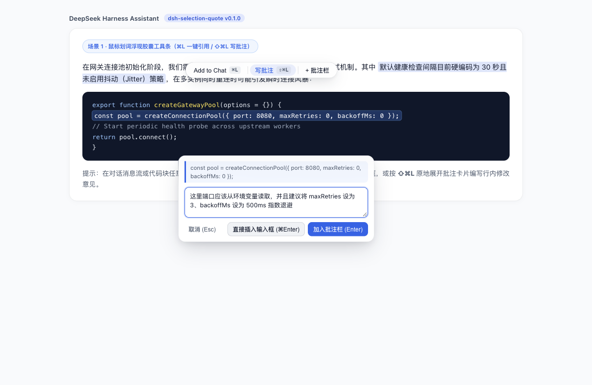

# dsh-selection-quote

**Cursor + GitHub PR Review 风格划词一键引用（`⌘L`）+ 行内写批注（`⇧⌘L`）+ 输入框上方批注汇总栏插件**，专为 DeepSeek Harness (DSH) 打造。

*Cursor + GitHub PR Review style Selection Add to Chat (`⌘L`), Inline Selection Comment (`⇧⌘L`), and Quotes & Comments Dock plugin for DeepSeek Harness (DSH).*

---

## ✨ 核心特性 (Features)

1. **划词浮动胶囊条（Selection Floating Toolbar）**
   - 在当前会话消息流区域（Assistant 回复、Markdown 正文、代码块、工具输出等，自动排除底部 Composer 输入框自身）选中非空文本后，在选区正上方居中浮现圆角胶囊工具条：`[ Add to Chat  ⌘L  |  写批注  ⇧⌘L  |  + 批注栏 ]`。
   - 自适应浅色 / 深色主题，半透明毛玻璃背景与柔和阴影，靠近视口顶部时自动向下翻转避让。
   - 原生快捷键支持：有选区时按 `⌘L`（Windows/Linux 为 `Ctrl+L`）触发「Add to Chat」，按 `⇧⌘L`（`Shift+Ctrl+L`）触发「写批注」，按 `Esc` 或点击空白区域收起。
2. **能力 A：一键引用到对话框（Add to Chat `⌘L`）**
   - 点击 `Add to Chat`（或按 `⌘L`），自动将选中文本转换为标准 Markdown 引用块（`> 选中文本\n\n`），通过 `ctx.conversation.input.shell(sessionId)` 写入底部聊天输入框草稿并自动聚焦。
3. **能力 B：原地展开行内批注卡片（Add Comment `⇧⌘L`）**
   - 点击 `写批注`（或按 `⇧⌘L`），浮动胶囊条原地平滑展开为紧凑的**批注输入卡片（Comment Card）**：
     - **顶部原文预览**：2 行截断预览选中的原文，左侧带蓝色竖线引用条；
     - **中部批注输入框**：展开后自动获焦，支持 `Enter` 确认加入批注栏、`⌘Enter` 直接插入底部输入框、`Shift+Enter` 换行、`Esc` 取消。
4. **底部输入框上方的「引用与批注栏」（Quotes & Comments Dock）**
   - 基于 DSH 原生 `"conversation.composer.dock"` 会话级插槽构建，队列为空时零高度、零 DOM 占用。
   - 支持针对长篇回复或长代码块连续划选多处片段分别写批注，每张卡片展示 `#序号 引用原文摘要` + `批注内容`，支持**点击内联修改批注**、**单条插入 (`↵`)**、**单条删除 (`×`)** 与 **一键清空**。
   - 提供 **「一键汇总插入输入框」** 按钮，将队列中所有「原文 + 批注」一次性格式化为结构化 Markdown 写入底部输入框草稿。

---

## 📸 实机运行截图 (Screenshots)

### 1. 鼠标划词浮现胶囊工具条与原地展开批注卡片 (`⌘L` / `⇧⌘L`)


### 2. 底部输入框上方「引用与批注汇总栏」与一键汇总插入 Markdown


---

## 🏗️ 运行时架构 (Architecture)

```mermaid
flowchart LR
  Sel["用户在消息流/代码块<br/>鼠标划词选中文本"] --> Overlay["conversation.input.overlay<br/>选区校验与坐标计算"]
  Overlay --> Pill["浮动胶囊条<br/>Add to Chat ⌘L | 写批注 ⇧⌘L"]
  Pill -- "点击 Add to Chat / ⌘L" --> Shell["SessionInputShell<br/>写入草稿并自动聚焦"]
  Pill -- "点击 写批注 / ⇧⌘L" --> Card["原地展开批注卡片<br/>原文预览 + 自动聚焦输入"]
  Card -- "Enter 加入批注栏" --> Store["会话级响应式 Store<br/>Quotes & Comments Queue"]
  Card -- "⌘Enter 直接插入" --> Shell
  Store --> Dock["conversation.composer.dock<br/>输入框上方批注汇总栏"]
  Dock -- "一键汇总插入输入框" --> Shell

  style Sel fill:#e3f2fd,stroke:#1565c0,color:#0d47a1
  style Overlay fill:#e0f2f1,stroke:#00695c,color:#004d40
  style Pill fill:#fff8e1,stroke:#ff8f00,color:#e65100
  style Card fill:#fff8e1,stroke:#ff8f00,color:#e65100
  style Store fill:#fce4ec,stroke:#ad1457,color:#880e4f
  style Dock fill:#e8f5e9,stroke:#2e7d32,color:#1b5e20
  style Shell fill:#c8e6c9,stroke:#2e7d32,color:#1b5e20
```



---

## ⌨️ 快捷键一览 (Keyboard Shortcuts)

| 触发场景 | macOS 快捷键 | Windows / Linux 快捷键 | 功能说明 |
| :--- | :--- | :--- | :--- |
| 消息流存在有效文本选区 | `⌘L` | `Ctrl+L` | 将选中文本转为 `> 引用块` 直接插入底部输入框草稿并聚焦 |
| 消息流存在有效文本选区 | `⇧⌘L` | `Shift+Ctrl+L` | 原地展开行内「写批注」卡片并自动聚焦批注输入框 |
| 批注输入卡片已展开 | `Enter` | `Enter` | 将当前「引用原文 + 批注」加入底部输入框上方的批注汇总栏 |
| 批注输入卡片已展开 | `⌘Enter` | `Ctrl+Enter` | 将当前「引用原文 + 批注」直接插入底部输入框草稿 |
| 批注输入卡片已展开 | `Shift+Enter` | `Shift+Enter` | 在批注输入框内换行 |
| 浮动胶囊条或批注卡片显示中 | `Esc` | `Esc` | 关闭浮动工具条或取消当前批注编辑 |

---

## 📦 安装与挂载 (Installation)

### 方式一：通过 npm 安装
```bash
npm install dsh-selection-quote
```

### 方式二：在 DeepSeek Harness Profile 中启用
在 `~/.dsh/profiles/desktop/package.json` 的 `dependencies` 与 `dsh.profile.bundles` 中添加 `"dsh-selection-quote"`，并在 `cordis.patch.yml` 中配置：

```yaml
- id: selection-quote
  name: dsh-selection-quote
  config:
    enabled: true
    addToChatMode: direct
    commentLabel: 批注
```

---

## ⚙️ 配置项说明 (Configuration)

| 配置键 | 类型 | 默认值 | 说明 |
| :--- | :--- | :--- | :--- |
| `enabled` | `boolean` | `true` | 是否启用划词浮动胶囊条、快捷键与底部批注汇总栏 |
| `addToChatMode` | `'direct' \| 'dock'` | `'direct'` | 点击 `Add to Chat (⌘L)` 时直接插入输入框草稿（`direct`）或加入上方批注汇总栏（`dock`） |
| `commentLabel` | `string` | `'批注'` | 生成结构化 Markdown 时使用的批注前缀标签（如 `**批注**：...`） |

---

## 🧪 运行测试 (Testing)

```bash
npm test
```

## 📄 开源协议 (License)

[MIT](./LICENSE) © 2026 xt765
