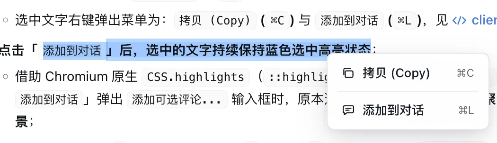
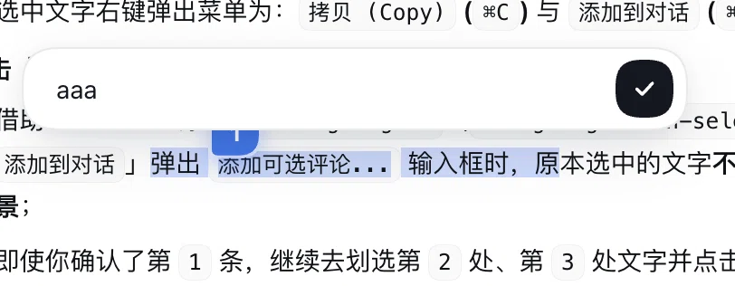
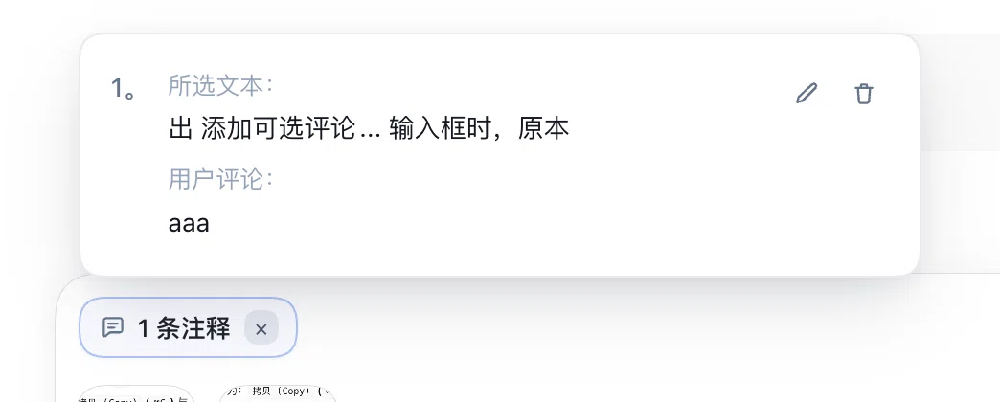
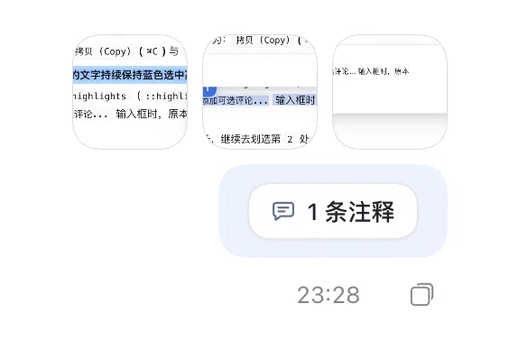

# dsh-selection-quote

**Codex + Cursor 风格划词右键「添加到对话 (`⌘L`)」+ 持续选中高亮 + 蓝色水滴序号角标与圆角胶囊评论框 + 输入框及已发送消息「`💬 N 条注释`」胶囊插件**，专为 DeepSeek Harness (DSH) 打造。

*Codex + Cursor style Selection Context Menu (`Copy` / `Add to Chat ⌘L`), Persistent Selection Highlight, Blue Numbered Teardrop Pin Badges, Rounded Capsule Comment Input, and Compact `N Comments` Pill & Hover Detail Popover for DeepSeek Harness (DSH).*

---

## ✨ v0.2.0 核心特性 (Features)

1. **无感划词 + 原生级右键菜单（`拷贝 (Copy)` / `添加到对话 ⌘L`）**
   - 普通鼠标划词时**不强行弹窗、不抢夺焦点**，完全保留原生选区高亮与 `⌘C` 复制体验。
   - 在选中文字上点击**鼠标右键**时，弹出毛玻璃右键菜单：**`拷贝 (Copy)` (`⌘C`)** 与 **`添加到对话` (`⌘L`)**。
2. **持续选中高亮（`CSS.highlights`）+ 蓝色水滴序号角标（`1`、`2`…）+ 圆角胶囊评论框**
   - 点击右键菜单中的 **「添加到对话」**（或直接按 `⌘L`），选区正上方浮现 **`添加可选评论...`** 圆角胶囊输入框（右侧带圆形 `✓` 确认按钮，支持 `Enter` 确认或留空仅引用原文）。
   - 借助 Chromium 原生 `CSS.highlights`（`::highlight(dsh-selection-quote)`）渲染管线，**即使焦点进入评论输入框或连续添加第 1、2、3 处引用，原文中的所有被选片段依然持续保持蓝色选中高亮状态**。
   - 每处选区首行右上角自动锚定一枚**蓝色水滴序号角标**（`1`、`2`…），随消息滚动实时跟随，点击任意角标即可原地重新编辑该条评论。
3. **输入框内嵌「`💬 N 条注释 ×`」胶囊 + 悬浮详情卡片 + 无正文直接发送**
   - 确认后的注释以紧凑的 **`💬 1 条注释 ×`** / **`💬 2 条注释 ×`** 胶囊形态内嵌在底部输入框左上方。
   - 鼠标悬停或点击该胶囊时，正上方弹出圆角详情卡片，按 `1。`、`2。` 分隔展示每条的 **`所选文本：`** 与 **`用户评论：`**，右上角提供**铅笔编辑图标**与**垃圾桶删除图标**。
   - **支持仅含注释直接发送**：当存在待发送注释时，即使底部输入框不额外打字，右下角发送按钮也会自动激活，按 `Enter` 或点击发送即可直接发出。
4. **已发送消息自动渲染为「`💬 N 条注释`」胶囊 + 独立正文气泡**
   - 基于 `uiConversation.userText.register` 与 `conversation.user.text.node` 插槽，发送出去的消息同样自动渲染为右上角的 **`💬 N 条注释`** 胶囊（悬停或点击即可查看所有「所选文本 + 用户评论」详情卡片），附加输入的文字则独立显示在下方的用户消息气泡中。

---

## 📸 实机运行截图 (Screenshots)

### 1. 划词右键弹出「`拷贝 (Copy)` / `添加到对话 ⌘L`」菜单


### 2. 点击「添加到对话」后展开圆角胶囊评论框 + 蓝色水滴序号角标 `1` + 持续蓝色选中高亮


### 3. 底部输入框内「`💬 1 条注释 ×`」胶囊与悬浮详情卡片（所选文本 / 用户评论 / 编辑 / 删除）


### 4. 已发送消息自动渲染为「`💬 1 条注释`」胶囊


---

## 🏗️ 运行时架构 (Architecture)

```mermaid
flowchart LR
  Sel["用户在消息流划词<br/>右键点击「添加到对话 ⌘L」"] --> Highlight["CSS.highlights 持续蓝色高亮<br/>+ 蓝色水滴序号角标 (1, 2...)"]
  Highlight --> Capsule["圆角胶囊输入框<br/>添加可选评论... + ✓ 按钮"]
  Capsule -- "Enter / 点击 ✓" --> Store["会话级响应式 Store<br/>Quotes & Comments Queue"]
  Store --> Chip["底部输入框内嵌胶囊<br/>💬 N 条注释 × + 悬浮详情卡片"]
  Chip -- "Enter / 点击发送<br/>(支持无额外文字直发)" --> Submit["SessionInputShell.submit<br/>合并发送并清空队列"]
  Submit --> Sent["uiConversation.userText<br/>已发送消息 💬 N 条注释 胶囊"]

  style Sel fill:#e3f2fd,stroke:#1565c0,color:#0d47a1
  style Highlight fill:#e0f2f1,stroke:#00695c,color:#004d40
  style Capsule fill:#fff8e1,stroke:#ff8f00,color:#e65100
  style Store fill:#fce4ec,stroke:#ad1457,color:#880e4f
  style Chip fill:#e8f5e9,stroke:#2e7d32,color:#1b5e20
  style Submit fill:#e8f5e9,stroke:#2e7d32,color:#1b5e20
  style Sent fill:#c8e6c9,stroke:#2e7d32,color:#1b5e20
```



---

## ⌨️ 交互与快捷键一览 (Interactions & Shortcuts)

| 触发场景 | 操作 / 快捷键 | 功能说明 |
| :--- | :--- | :--- |
| 消息流选中文本后右键 | 点击 **`拷贝 (Copy)`** / `⌘C` | 将当前选中的文字复制到系统剪贴板 |
| 消息流选中文本后右键 | 点击 **`添加到对话`** / `⌘L` | 保持选中文字持续蓝色高亮，弹出圆角胶囊评论框与蓝色水滴序号角标 |
| 圆角胶囊评论框已展开 | `Enter` 或点击右侧 **`✓`** | 将当前「所选文本 + 用户评论」加入底部输入框的 **`💬 N 条注释 ×`** 胶囊 |
| 圆角胶囊评论框已展开 | `Esc` | 关闭当前圆角胶囊评论框 |
| 底部输入框存在 `💬 N 条注释 ×` | 悬停或点击胶囊 | 弹出详情卡片，查看每条「所选文本 / 用户评论」，支持铅笔编辑与垃圾桶删除 |
| 底部输入框存在 `💬 N 条注释 ×` | 直接按 `Enter` 或点击发送按钮 | 即使不输入额外文字也可直接发送，并在已发送消息处渲染为 **`💬 N 条注释`** 胶囊 |

---

## 📦 安装与挂载 (Installation)

### 方式一：通过 npm 安装
```bash
npm install dsh-selection-quote
```

### 方式二：在 DeepSeek Harness Profile 中启用
在 `~/.dsh/profiles/desktop/package.json` 的 `dependencies` 与 `dsh.profile.bundles` 中添加 `"dsh-selection-quote"`，并在 `cordis.patch.yml` 中配置：

```yaml
- id: selection-quote
  name: dsh-selection-quote
  config:
    enabled: true
    addToChatMode: dock
    commentLabel: 批注
```

---

## 🧪 运行测试 (Testing)

```bash
npm test
```

## 📄 开源协议 (License)

[MIT](./LICENSE) © 2026 xt765
